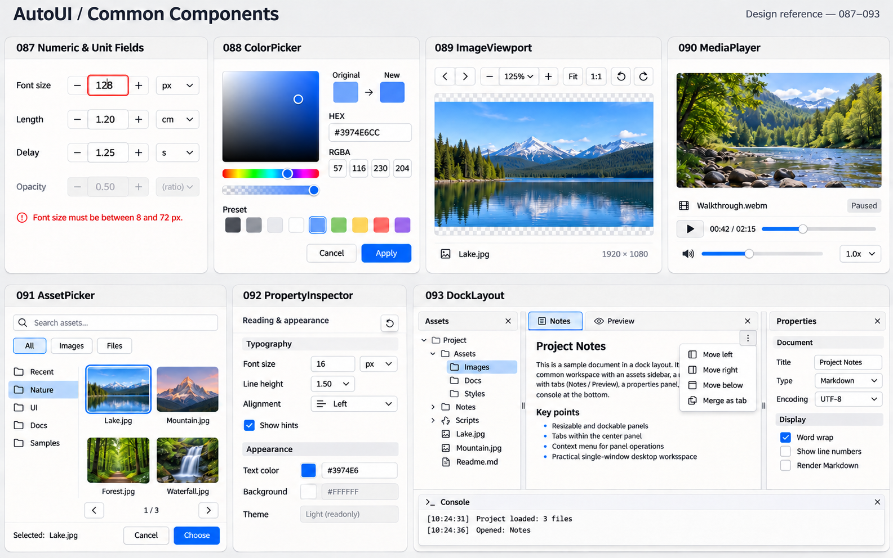

# 087–093 通用组件执行与视觉参考

> 2026-11-14，r1。配套各Plan r2；这是执行设计，不是当前已交API或产品验收。各Plan §5–8仍是对应模块的唯一执行合同，本页提供共同约定、视觉标尺和测试交接格式。

## 1. 先读什么

执行者从自己的Plan开始，读本页，再读该Plan §4列出的Spec、源码和实际消费方。不要求实施七组件组合应用，不为做参考图额外建设“超级编辑器”。每个组件分别交付、分别验收。顺序/来源导航仍在[组件库strategy](component-library-extension-strategy.md)。

1. 核实实际仓库、分支、工作树、HEAD和输入摘要；不覆盖其他任务改动。
2. 执行T-01的整链小探针，明确真实包导入、事件负载、最小必要底层适配和runner。它验证合同的可行性，不再自由决定公共语义。
3. 从Plan r2接口和数据样例开始实现；不可行之处先留带输入/命令/观察值的决策记录，修改合同须增revision，不能默默交另一种API。
4. 只有T-01机械可行性及对应依赖交付pin齐备，才关闭该Plan规定的后续任务。新的测试脚本在T-05实现前均是拟议入口。

## 2. GPT生成的视觉参考



使用内置GPT图片生成功能生成，并针对状态一致性做了一次定向编辑；不是运行截图。最终图1585×992，SHA256 `F4DA10C65FDC266F7ED574E9351A65653B66FDA631926D71AEAAF391FCCA41C1`；完整[生成与编辑提示](assets/common-components-087-093-reference-v1-prompt.md)随仓库保存。

图按七个编号展示不同组件，不能把它当成七个组件必须一起出现的页面。它约束布局关系、视觉层次、紧凑度和状态区分；实现依据下面的逻辑尺寸与实际主题，不测生成图的物理像素作像素级还原。图中英文文案、图片、字段示例不冻结为产品数据，正式示例使用可本地化文案和可再分发夹具。

图中087的128字号是超出8…72范围的**错误草稿**，应用正式值仍应是原16；Opacity为普通只读数值示例，不增单位换算组。090的暂停标签对应下方播放按钮。092示例的整组恢复图标在v1应落实为各字段恢复入口，不能因图片新增“批量事务/全部恢复”功能。093内的checkbox/文档只是承载内容，不成为DockLayout自带业务。

## 3. 统一视觉尺寸和状态

全部尺寸为100%缩放下的逻辑像素；主题有正式density时以主题值为准并记录映射。使用已有Auto/Solarized、light/dark语义角色，不把图中蓝/白硬编码为内容或主题数据。

| 项 | 默认规格 / 实现要求 |
|---|---|
| 网格与间距 | 4px基本刻度；控件内间距8；组间16；面板内边距16；密集工具栏8…12 |
| 字体 | 正文13…14、辅助/label12、组件标题14…16；沿宿主字体与CJK回退，数字用等宽数字特性；不能靠缩字号掩盖溢出 |
| 输入/按钮 | 默认高32，icon按钮28…32见方；输入边框1，圆角6；不要每种组件自造不同高度 |
| 面板/对话框 | 面板圆角8…10、细分隔线；Dialog沿现有模态chrome；不用重阴影/玻璃/大面积装饰渐变 |
| 主题映射 | 使用当前background/card/foreground/muted/border/primary及现有错误/focus语义，按实际主题字段解析；本页不新增公共token |
| focus | 明确2px视觉环或等价高对比边框，键盘可见；与selected分开，不能只靠颜色表明选中 |
| hover / selected | hover轻底色；selected用主题浅底+边框/勾选标记等明确结构；不改变尺寸引起重排/焦点丢失 |
| readOnly / disabled | 只读可读/可复制但不能修改；disabled移除修改动作且明显弱化。两者不能都只写CSS opacity而保留可执行handler |
| invalid / pending | 字段旁文字说明及错误结构；pending有文字/进度提示并按合同锁定重复动作；错误不等于空结果 |
| 图标 | 复用现有icon集合，16px常规；纯图标控件必须有语义名称及hover提示，不用emoji或缺字图标占位 |

### 3.1 各组件的布局和窄窗规则

| Plan / 图中区域 | 默认布局 | 窄窗/状态要求 |
|---|---|---|
| 087 / 左上 | label列约96…120，数字区域伸缩，步进按钮各28，单位选择约64…80；错误在对应字段下方 | 320px容器可将label移上方；不能切掉正负号/单位；错误不覆盖其他行 |
| 088 / 上第二 | Inline约360宽；ColorDialog首选480×560并夹取视口；色面≥180见方；通道对齐，预览/色板独立，底部取消/确认 | 420×560外窗内可竖向滚动正文，确认栏固定可达；通道可换行，色面与alpha不消失 |
| 089 / 上第三 | 视口伸缩、独立工具栏；图片元信息与缩放/平移/旋转动作不覆盖内容；Dialog首选960×720并夹取 | 常用按钮优先保留，更多平移/变换在普通命名菜单；图片区独立缩放，退出按钮始终可达 |
| 090 / 右上 | 视口和普通控制条分开；播放/时间/seek优先，音量/倍速右侧 | 窄窗允许两行控制条，不挤掉Play/时间；加载/未知时长/错误要能与Paused区分 |
| 091 / 左下 | Picker首选900×680并夹取；分类约160，搜索/类型上方，单选网格/列表主体独立滚动，选择摘要+确认栏固定 | 窄窗分类可变为可寻址下拉/按钮，缩略图至少两列或切列表；搜索/过滤允许换行；无匹配与provider失败分开 |
| 092 / 下第二 | 侧栏推荐320…360；组标题/折叠，字段label与编辑器两列，帮助/错误紧邻字段；默认恢复入口逐字段 | 宽度不足时字段上下排布；错误长文本换行；搜索/折叠不提交草稿；只读字段仍可读 |
| 093 / 右下跨两列 | 工作台1280×800参考；左栏约200、右栏280、主区余量、Console约160高；标题32，split handle命中区6…8 | 约束以面板minSize为准；空间不足时提供工作区滚动/面板菜单，不把minSize直接压成0；移动/恢复/重置入口始终可寻址 |

### 3.2 必须实际拍摄的状态

每个Plan的V-05与新增V-06分别记录：默认/hover/focus、选中（如适用）、disabled/readOnly、输入或provider错误、pending/loading、空态（如适用）、正常关闭/重开。两套主题模式+至少一个420×560窄窗；放大字体或DPI后检查label/数字/提示和footer。没有状态的组件标明不适用，不伪造一套占位控件。图片是风格参考，真实截图/语义值/业务读回才是验收证据。

## 4. 消息、受控状态及身份

本节是新包之间的消息约定，不是新MCP接口。各Plan r2表中所列公开事件用普通 `msg` 通道；有负载的事件为`str` JSON，无负载cancelled可以为空消息，接法沿现有FileDialog的`onaccepted: .Accepted($event)`。records/List等按既有`.at`机制承载，不把本页JSON样例当新语法。

- 请求类JSON含`seq`（本组件实例内递增）、`baseRevision`（对应受控props修订）和该组件的字段。`seq`不是全App唯一身份，回调作用域才决定实例；运行时节点还要绑定实际App/VM owner。
- `revision`是调用方的受控目标版本，变化须失效旧草稿/手势/排队动作；同revision出现相关props变化也要按实际内容失效旧绑定，不能把调用方忘增版本当成跨目标写入许可。
- `committed`意为用户结束了一次有效编辑、请求提交，**不是业务保存成功**。调用方决定正式状态、写入、权限和撤销。preview不默认写文档，cancel不覆盖外部已更新的正式值。
- 基础值变化和目标身份变化要分清：普通重绘不令每次输入节点都失效；失效针对owner、资源/对象、会话或影响动作含义的revision。验证旧节点时配当前正例，不能误把所有正常连续操作也拒绝。
- `error`至少`{code,message}`，可附fieldId/requestSeq；同错误配置仅在配置变化时报告一次，不每帧发回调。异步业务错误由受控错误props反馈，不能把错误假装成功。

以下用法是r2拟议公开接口，新增包实施后由T-01/T-02补成真实可编译fixture；不是声称当前仓库已经能直接调用：

```auto
widget Settings {
    use { package: fields from "<resolved-numeric-fields-package-dir>" }
    msg { SizeRequested(str) }
    model {
        var size str = "16"
        var revision int = 1
    }
    view {
        NumericField (value: .size, revision: .revision, precision: 0,
            min: "8", max: "72", step: "1", label: "字号",
            oncommitted: .SizeRequested($event)) {}
    }
    // handler解析请求，按baseRevision验证后更新size/revision；不使用测试状态注入。
}
```

示例只展示调用位/事件，不是独立可运行应用；T-01须按真实descriptor/package布局补完整并通过实际生成。不得因为该片段是示意而任意改掉Plan冻结的事件语义。

## 5. T-01决策记录和可复用测试入口

每个Plan自己的`docs/reviews/planNNN/decisions.md`至少给出：

| 字段 | 关闭条件 |
|---|---|
| baseline | 实际仓库/树/branch/HEAD；相关源码/包/工具/依赖摘要，明确观察路径和新增路径 |
| public interface | 与本Plan r2表逐项对照；完整可解析fixture路径和实际生成命令/结果，不只做字符串断言 |
| mechanism probe | 一个合法整链样例及关键失败控制，源→解析/生成→实际事件→消费结果；尚缺的底层机制具名定位 |
| dependencies | 每个硬依赖的Plan/交付提交/包文件集合和摘要；未交依赖可用最小探针调查，但不能用stub冒充T-03交付 |
| runners | Win/Linux native与Vue各自可用环境；缺哪个标not_run，不自动删验收；记录能运行的准确命令和工作目录 |
| next | 允许进入的下一任务，未满足的前置/缺口及owner；未决机制不能混入T-02当自由设计 |

已有native参考为`tests/product/verify_file_dialog.py`的进程归属、窗口、MCP、负例、退出重开设施。**不能原样复用其Session构造器**：它写入FileDialog专用env、等“选择文件”并绑定专用窗口/退出文案。只复用核验过的通用函数/模式，各组件session必须按自己的真实标题、就绪状态和退出控件适配。不能把文件窗就绪作为其他组件已经启动。

Vue参考为`examples/ui/030-video-player/tests/`的Playwright启动/真实媒体断言，以及`examples/ui/031-image-viewer/tests/{README.md,vue-actions.json}`。旧030配置会指向用户媒体盘并关闭autoplay策略，**新090验收不能照抄**；用隔离PCM WAV/WebM和普通用户激活动作，保留真实浏览器策略。旧mpv测试文件头仍写auto-lang包名，当前执行包应为auto-ui-runtime；测试中缺lib而自跳过不能当新090真实解码门通过。

新Python product scripts的共同拟议参数：`--auto-bin`、`--ui-tool-bin`、`--out-dir`、`--backend native|vue`；浏览器侧用真实生成应用/Playwright页面操作，native侧用真实MCP。T-05实现CLI/help并把实跑命令落入证据。通用输出至少包含：

```json
{"plan":"087","revision":2,"backend":"native","platform":"windows",
 "source":{},"tools":{},"dependencies":[],"cases":[],
 "visual":[],"cleanup":{},"reopen":{},"result":"not_run"}
```

字段为证据结构示例，非生产API；每个case记录ID、入口、观察值、预期、pass/fail/not_run、原始路径。退出码0只在本次所需case全部pass且正常清理/重开完成时返回；平台缺失单列，不能用合并总green掩盖。无需本批新造通用测试平台；公共测试设施若确需改动，先指定单一Plan owner，避免七份Plan同时重写。

## 6. 交付与复审

每个包README含一次可运行导入/事件消费示例、props/events/错误、依赖闭包及支持矩阵；证据同时包含数值/身份/像素或bounds的真实结果，不能只有生成图。T-06准备Spec delta；T-07独立实施验收通过后，T-08才沉淀canonical Spec、交付/归档/strategy链接和实际清理。当前文档复核不替代后续独立产品review。
