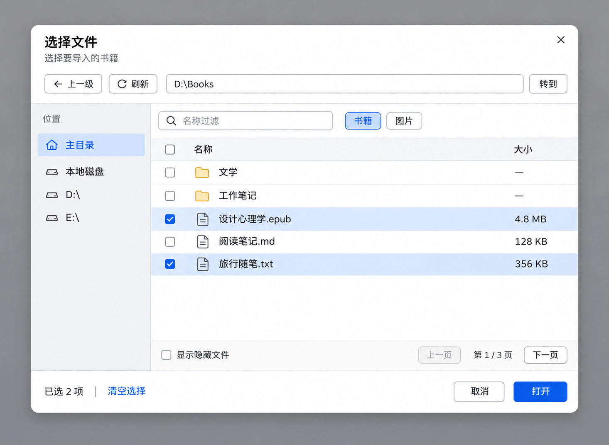
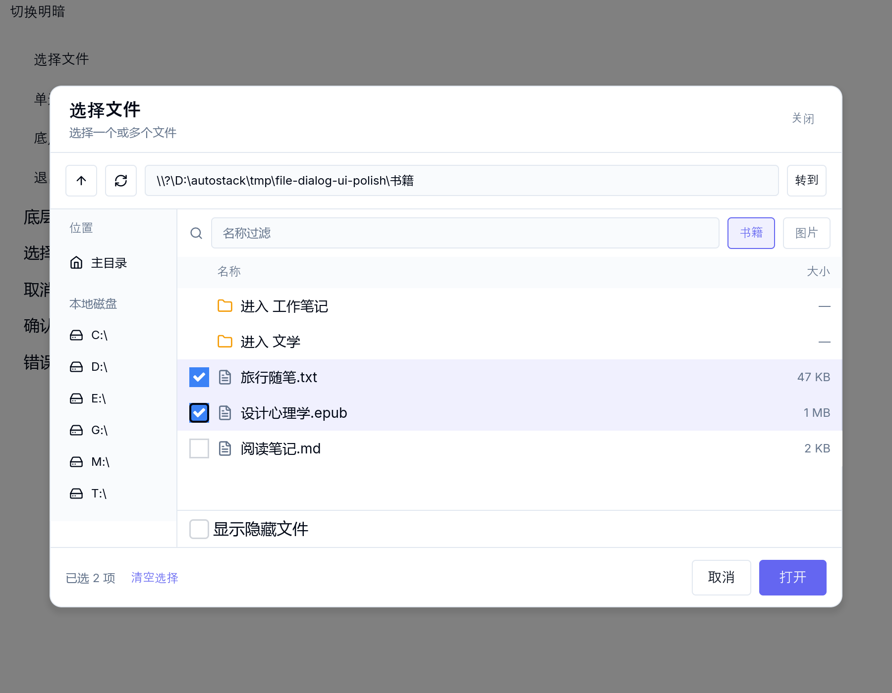
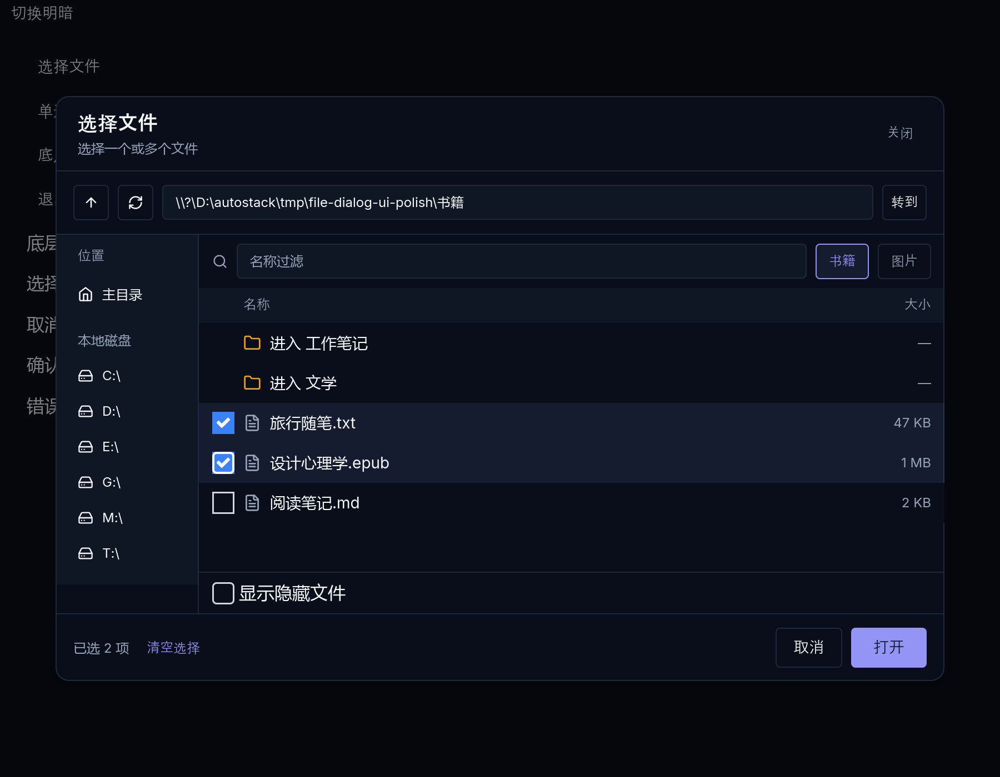
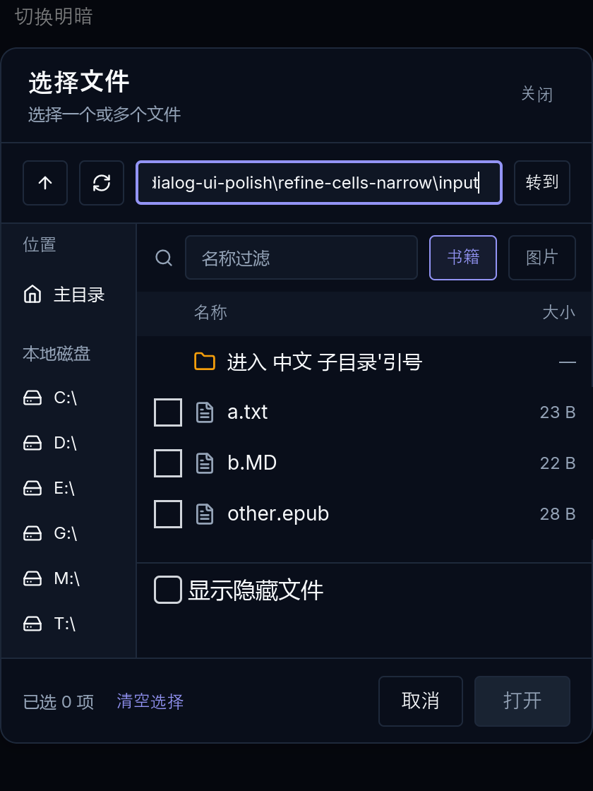
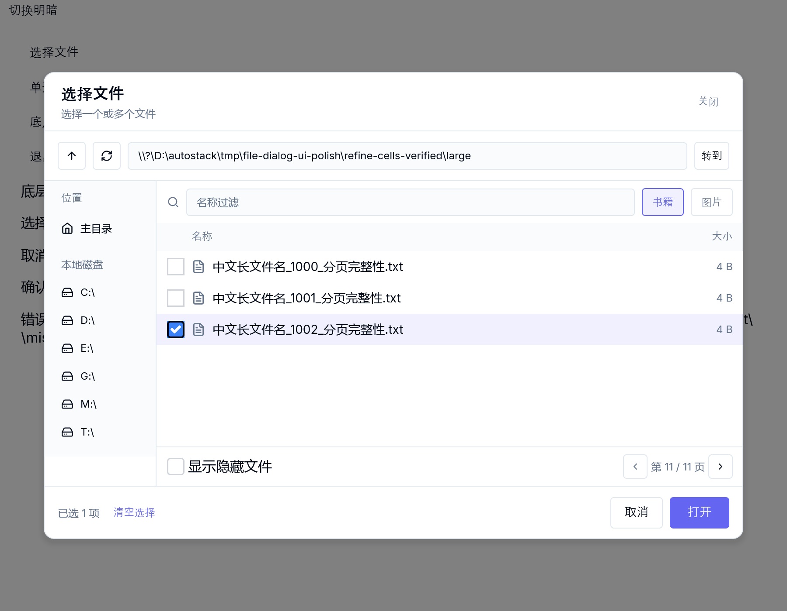

# FileDialog UI polish — 2026-11-13

用户反馈 PLAN-082 完成后的界面缺少桌面文件选择器的质感。本次实拍检查发现：原生 Dialog 固定约384px宽，忽略dialog-content尺寸；导航/根位置/路径/过滤/提示/分页都堆在外层滚动区，文件区被挤压，确认操作没有视觉主次。

参考图由内置GPT图像生成功能生成，仅作为布局参考；产品仍由原生AutoUI控件绘制，不把图片嵌进组件，也不引入浏览器界面。

实现：800px首选宽度并受视口约束；位置侧栏、紧凑路径工具栏、独立滚动列表和固定选择/操作底栏；当前类型与选中行使用主题primary色的浅底；文件夹/文件图标、B/KB/MB大小、禁用确认按钮；小窗口缩窄侧栏/列表。目录选择、文件类型、单/多选、错误处理和MCP action语义沿现有合同，不修改Reader导入事务。原生Dialog内容样式在ordinary/tracked两条路径中一致生效，未指定样式的Dialog保留原尺寸。

组件公共源为 `packages/file-dialog/file_dialog.at`。Reader现有vendor快照/已运行工具不会因本次源修改自动升级，消费时需要同步官方包并使用含Dialog样式修复的新UI工具；本次不接管009工作树或改其pin。

本次不重开已归档082，不把视觉改进冒充原计划重新交付或Reader全量回归。

## 实际原生截图

以下为Windows真实VM窗口，通过普通MCP多选后截取；不是生成图。

## 验证与边界

2026-11-13，`auto-ui`主检出基线`6ae5bb8b`上本次未提交修改；没有提交/合并其他人的设计和计划WIP。使用新构建的本仓`target/debug/auto-ui-tool.exe`，SHA256 `4C379A672553E765DE879A719911AC3F0BBCDAC459D80FB5D67B6D6BCB61A501`。

| 入口 | 实际结果 |
|---|---|
| `cargo test -p auto-ui-runtime --test file_dialog --test file_dialog_model --locked` | 8+10通过；包括新增普通/带调试信息视图中的Dialog尺寸覆盖及旧默认尺寸对照 |
| `cargo test -p auto-ui-tools --test file_dialog_component --locked` | 3/3通过，保留原checkbox依赖/官方包一致性断言 |
| `python tests/product/verify_file_dialog.py --auto-bin D:/autostack/auto-man/target/debug/auto.exe --ui-tool-bin D:/autostack/auto-ui/target/debug/auto-ui-tool.exe --out-dir D:/autostack/tmp/file-dialog-ui-polish/product-delivery` | Windows完整真实VM门pass；单/多选、键盘Space/Tab/Shift+Tab、当前树发现、系统无障碍、模态背景拒绝、过期行、筛选/错误恢复、1003条分页与尾项、10轮取消重开、干净关闭/新会话/端口回收 |
| 同一产品入口加`--window 420x560 --visual-only`，输出`product-compact-final` | 明暗/滚动/选择回写/底部可操作pass；最终小窗列表高度单独复验，下一页文案不换行，底部按钮可见 |
| 额外MCP实窗多选 | 两个书籍文件accepted回调落盘，精确文件名/绝对路径身份读回通过；实拍明暗图 |

本地回执：`D:/autostack/tmp/file-dialog-ui-polish/product-delivery/report.json` SHA256 `9B5545142BBBCB1E41F1D0DB9DCCC47836B05F633304F5F9BDF076C30CF25D41`；`product-compact-final/report.json` SHA256 `7CEFCAD4A4E9B957E6DF05B18CD8C0453858E407EBC01D5E26C858B3D7E765F2`。其他日志/前后截图同一自有临时目录。

回归发现并关闭的两点：列表格式化曾通过VM逐项清空/重建entries，改为runtime一次性投影sizeLabel，保持原子列表赋值；选中行与未选中行都保留相同hover/background结构，避免重挂载丢键盘焦点。隐藏文件checkbox保留原组件映射，不用样式强制退化为原生HTML输入框。测试的滚动定位改为从当前树寻找含文件checkbox的列表，不再误把新增的位置侧栏当文件列表。

本轮没有重跑Linux实机或Reader009完整矩阵；不宣称这些消费者/平台已验新版。已运行Reader和vendor快照保持原状态，消费时需同步包及新工具。

## 参考图生成提示

内置图像生成；完整提示见同目录 `file-dialog-ui-reference-prompt.txt`。图片是设计参考，非运行截图；实际颜色随AutoUI主题改变。

## 四点修订（2026-11-13，用户追加反馈）

- 上一级/刷新改为纯图标，保留命名悬停提示；MCP按当前树中的提示名称定位并执行图标按钮。
- 固定20px复选框列与独立名称列；文件图标属于名称列，目录行保留同宽空白列，大小列右对齐。方形checkbox单元格只绘制控件，语义名称仍保留完整文件名；不使用零字号隐藏名称。
- 名称过滤、书籍/图片组位于同一行，过滤输入使用剩余空间，不把类型组挤到下一行。
- 显示隐藏文件与页码/图标翻页按钮同一行；pageCount≤1时不生成整个翻页组。空结果也不显示无意义页码。

最终验证工具SHA256：`AC2405B5489A4C714549D3949422C391974E9D5DD597DA576987CA3910F26B97`，本仓新构建并复制到自有临时目录的`auto-ui-tool-refine-cells.exe`；没有结束用户其他会话。本次截图为真实VM产品窗。

Windows完整产品门`D:/autostack/tmp/file-dialog-ui-polish/refine-cells-verified/report.json`为pass：额外实测图标刷新/上一级、单页无翻页节点、系统UIA复选框保留文件名且边界为方形，原1003条分页、单/多选、键盘、取消重开与正常退出/新会话仍通过。420×560明暗及底部操作门`refine-cells-narrow/report.json`为pass；另外真实执行窄窗第1页→第2页。包生成三个测试通过。

产品门发现并修正一个进程归属误判：仅看父PID会把更早启动、保留历史父PID的无关系统服务误算成本次子进程；现在同时核验进程创建先后关系。未操作该无关服务。单页隐藏断言和图标按钮定位已随当前UI更新，未降低原业务/文件身份/分页完整性门槛。

最终runtime两组8+10通过，生成兼容3/3通过，合计21项。产品回执SHA256：`refine-cells-verified/report.json`=`D586FEE3FA4C0F31278131ABFC4D77EEA616C875C4677D1CA78E4CABBFA223B8`；`refine-cells-narrow/report.json`=`E059470427C53E5E6AE89E2860C9CA3E72918794A0B8E17D13C23BB1282EAAD2`。

这些修订沿同一官方组件源完成；Linux实机与Reader副本更新仍不在本轮验证声明内。
