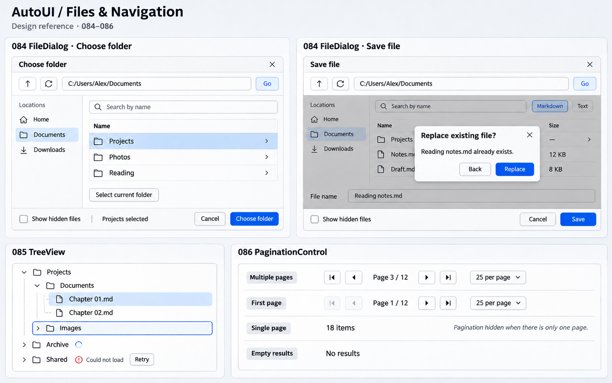
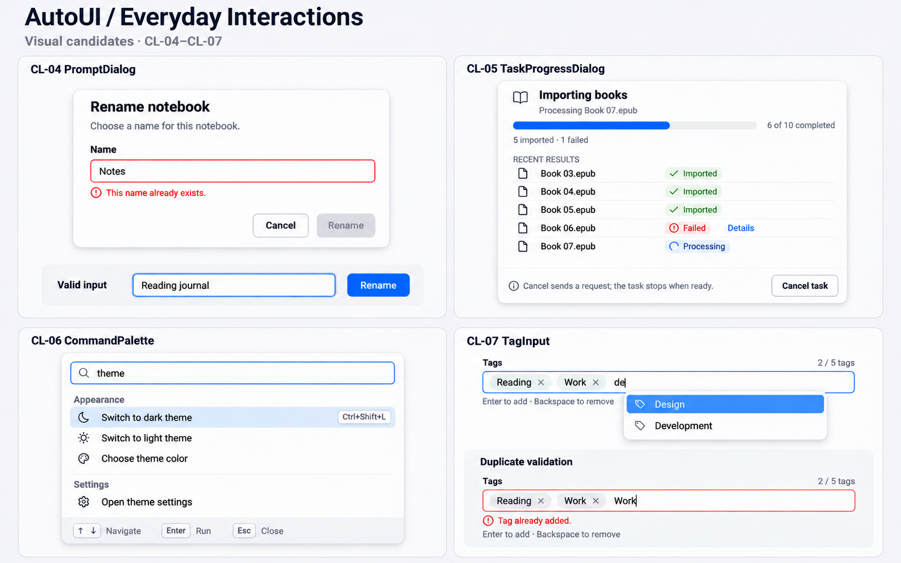

# 文件导航与轻量交互组件视觉参考

> 2026-11-14，r3。CL-01…09视觉入口；094–097复核为drafting r2、0/8；085仍drafting r2。084/086代码交付归档，既有Linux/统一回归及DEBT-006缺口保留；088/089沿原合同。四组件PNG/提示字节不变，图片不是运行截图。

## 1. 组件与计划对应

| 组件 | 参考区域 | 当前入口 |
|---|---|---|
| FileDialog目录选择/保存 | 文件导航图上方两区，含覆盖确认 | [PLAN-084归档](../../plans/archived/084-file-dialog-folder-and-save-modes.md)；既有打开模式仍看[原UI改进与实拍](file-dialog-ui-polish.md) |
| TreeView | 文件导航图左下 | [PLAN-085](../../plans/085-official-tree-view-component.md) |
| PaginationControl | 文件导航图右下四个状态 | [PLAN-086归档](../../plans/archived/086-shared-pagination-control.md)；代码交付，保留待补验证门 |
| PromptDialog | 轻量交互图左上 | [PLAN-094](../../plans/archived/094-prompt-dialog.md)，Windows r3 已交付 |
| TaskProgressDialog | 轻量交互图右上 | [PLAN-095](../../plans/095-task-progress-dialog.md)，drafting r2，0/8 |
| CommandPalette | 轻量交互图左下 | [PLAN-096](../../plans/archived/096-command-palette.md) r3 已交付 Windows Native VM 与 Vue |
| TagInput | 轻量交互图右下 | [PLAN-097](../../plans/archived/097-tag-input.md)，Windows r2 已交付（Linux 两轨 not_run，084 §10 路由） |
| ColorPicker / ColorDialog | 已有087–093图上方088区 | [PLAN-088](../../plans/088-color-picker-and-dialog.md)，见[执行/视觉指南](common-components-execution-and-visual-guide.md) |
| ImageViewport / ImagePreviewDialog | 已有087–093图上方089区 | [PLAN-089](../../plans/archived/089-image-viewport-and-preview-dialog.md)，沿同一执行/视觉指南 |

各组件只实现自己合同的区域；无需为参考图开发一个九组件组合页面。图片统一存`docs/design/autoui/assets/`，计划通过相对链接引用一份源，不在每个Plan目录复制，不依赖会话attachments或个人缓存。最终PNG和生成提示作为仓库设计资产供Git管理；本轮不提交其他任务的工作区变更。

## 2. 文件与导航 084–086

内置GPT图片生成与一次定向编辑，最终1585×992 RGB；SHA256 `56028AF0BC95E954C1BCFE38A7CA646D07308DB477C81E0E427DB6562DBDB159`。[完整生成/编辑提示](assets/file-navigation-084-086-reference-v1-prompt.md)。

### 2.1 FileDialog

- 沿现有800px首选宽、视口夹取、路径工具栏、位置侧栏、列表独立滚动、固定操作区。Up/Refresh使用现有图标及命名hover提示；图中不展示tooltip不表示可以省略语义名称。
- 目录模式行选择与进入目录是独立动作，另有“选择当前目录”。只选目录，不显示文件多选checkbox和文件类型组；既有打开模式的独立checkbox列不因此取消。
- 保存模式增加文件名；格式组复用现有活动filter，默认扩展名和不匹配输入按084合同处理。图中Markdown选择对应`.md`候选；图例文件名/大小只是视觉内容，实际覆盖用例必须在隔离目录准备目标文件并重验其存在/身份。
- 覆盖确认是同App内的受控状态；图表达叠层关系，不许可确认层出现时底层Save/路径/列表继续可操作。Back返回编辑并保留草稿，Replace仅表达经重验的选择/覆盖意图，实际写入归应用。
- 图中的Windows路径不是固定语法。Linux用真实路径根及权限规则，同样布局/操作；不因为生成图是Windows路径就调用系统dialog。
- 文件名、过滤、显示隐藏文件与分页的布局沿旧改进合同；小窗可滚动正文，但取消/确认始终可达。Q-01可见文字缺失仍需真实窗口验证，不以图或MCP完整文本代替。

### 2.2 TreeView

缩进线/chevron、图标、label在稳定列中；chevron与label独立命中，前者请求展开，后者请求选择。图中Chapter 01选中，Images有focus ring，表示焦点与选择不同。loading和error/retry独立可见，不能用空children伪装失败。

节点ID不必画在UI上，但必须作为受控数据与MCP绑定身份。展开/加载由调用方props决定，不按生成图的箭头方向猜状态。disabled不生成选择/展开动作；禁止因图里的项目/文件夹示例给通用树新增文件系统业务。v1不含checkbox多选和拖放。

### 2.3 PaginationControl

多页、首面、单页、空结果是四个独立状态示例，不是页面上必须同时放四个分页器。多页/首面各自保持一行；首面first/previous禁用；单页/空结果在hideWhenSingle=true时整个分页组不存在，包括页码和页容量选择。

图中的“Pagination hidden…”是板外说明，不要求渲染到真实组件。“18 items”属于消费方内容摘要，不是偷偷保留的分页文本。非法配置错误不能靠单页隐藏掩盖。图中25 per page是可变页量消费者例子；FileDialog固定100、showPageSize=false，026可用10/25/50，沿086合同。

## 3. 轻量交互 CL-04…07

内置GPT生成与一次状态/文案编辑，最终1586×992 RGB；SHA256 `EF667ABE23CFDC6377DDCF9E38005D118DD55D9CDCAFFD92D449CF02A440DD13`。[完整生成/编辑提示](assets/everyday-interactions-cl04-cl07-reference-v1-prompt.md)。

四项现在分别由094–097定义接口、异步身份和消费合同，并在§5引用本页与同一PNG。图只指导布局，不冻结额外API、权限或任务执行策略；实现以各Plan的当前revision为准，不能从图的像素/文案反推状态机。

| 组件 | 可参考的视觉和状态 | 对应Plan已约定、仍待真实实施验证的事项 |
|---|---|---|
| PromptDialog | 标题/说明/单输入/紧邻错误/取消确认；Notes冲突时确认禁用，Reading journal是另一个有效状态 | 验证与提交中、Enter/重复提交、取消与外部更新、初始/恢复焦点；应用持重命名/创建行为 |
| TaskProgressDialog | 当前步骤、progress、计数、逐项状态/详情和取消请求；6/10含5成功1失败，列表是最近结果而非全部结果 | 确定/不确定进度、取消中/可取消能力、关闭与任务继续的区别、真实结果/错误及卸载后的任务owner；实际任务/重试归应用 |
| CommandPalette | 搜索、分组、选中行、快捷键提示及键盘帮助；示例结果均匹配theme | 稳定command ID、enabled、过滤/选中索引、上下/Enter/Esc、关闭恢复焦点；命令执行由应用，不能只改选中标签 |
| TagInput | chips、删除入口、输入、候选、计数、重复提示；Work重复不使2/5增加 | 去重规则/数量边界/空值/键盘/建议时序/真实提交；应用持标签ID、存储及权限；两个例子是不同状态 |

进度条的生成像素只作视觉示意；真实控件必须用完成数/总量或明确progress驱动，不能按PNG填充长度反推数据。图中文字说明“Cancel sends a request”不是已经取消的状态；未来取消中应有明确反馈并阻止重复请求。

## 4. 共用样式与验证

复用[既有执行/视觉指南§3](common-components-execution-and-visual-guide.md#3-统一视觉尺寸和状态)：32px常规控件、4px刻度/8px间距、16px面板padding、现有主题语义、outline图标、明确focus/selected/invalid/disabled/readOnly/pending。常规字体沿宿主，不硬编码英文图片字体；用真实中文/长路径测试。

084/086视觉合同及未关闭项沿各自归档收据，085仍需在T-05/06完成视觉case并绑定AC-06；不另开一个“只看图就通过”的任务。浅深模式、420×560窄窗、正常键盘/MCP、错误/空/loading/禁用、单页组不存在均以真实树/截图/消费读回证明。文件窗实际支持面仍是Win/Linux native VM；TreeView/Pagination还需Vue，不因图新增FileDialog浏览器任意磁盘访问。

094–097的§5已链接本指南/对应PNG，§6有P/J/C/G及X系列稳定Case ID，§7将视觉可读与键盘/MCP/实际消费绑定。Windows/Linux native VM与Vue逐门验收，中文、浅深色、420×560窄窗和适用错误/pending态均须真实截图；当前仍只完成计划。ColorPicker与ImagePreview仍使用088/089已有r2视觉门。

## 5. 资产版本与交接

[视觉资产清单](assets/basic-components-visual-references-v1.json)记录本次两张新图、复用图及提示的摘要，以及084–086和本页的验证快照。建议最终PNG、提示、指南、Plan引用与路线同次纳入Git；仅保存到工作目录不等于已提交。生成缓存和中间失败/废弃版本不作为Plan依赖。

原视觉资产清单及087–093执行复核收据保留生成/审核当时的快照，不因本次计划编号或指南r2变化回写旧摘要；PNG/提示字节未变。094–097使用当前指南和各自合同，本次不修改087–093及其公共参考图/指南，不替代或重跑产品门。检查仅覆盖计划结构/引用、资产和文档一致性。

## 6. 094–097 r2执行交接

四项各自§5/6已补实例token、明确反馈、现有Init/焦点复用接缝及具名反例。Windows/Linux native/Vue分别记录GUI、MCP、消费读回和适用视觉/输入桥；Playwright、MCP合成type、系统provider及物理输入证明不同路径，不能互相替代。Linux沿084确定的VMware+自制发行版路线，缺环境保持not_run。审核依据与闭环见[本次报告](../../reviews/component-plans-094-097-2026-11-14/README.md)。PNG及提示未重新生成，旧资产清单保留原快照。
